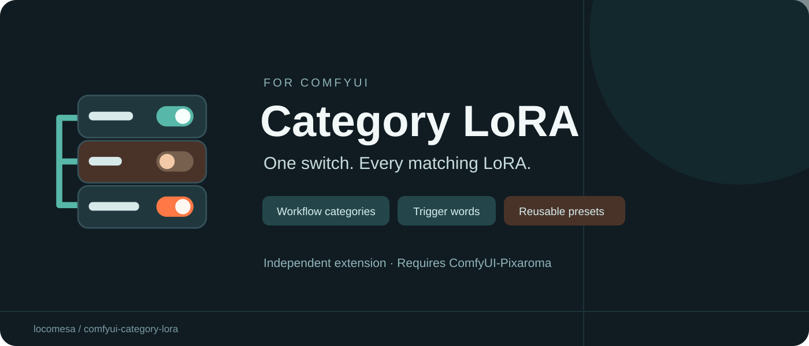

# Category LoRA for ComfyUI



[Comfy Registry](https://registry.comfy.org/nodes/category-lora) · [GitHub releases](https://github.com/locomesa/comfyui-category-lora/releases) · [Example workflow](examples/category-controls-demo.json)

A Pixaroma-style LoRA stack with workflow-wide category switches and reusable per-LoRA presets.

## Features

- Assign several categories to each LoRA, such as Eyes, Clothing or Style.
- One **LoRA Category Controls** node controls all **Category LoRA Loader** nodes in the current workflow, without control wires.
- Any disabled category excludes a matching row's weights and trigger words.
- Individual row switches and strengths are preserved. Uncategorized rows are unaffected.
- Store and restore categories, selected/custom trigger words, and model/CLIP strengths per LoRA file.

## Requirements

- ComfyUI with its web frontend.
- [ComfyUI-Pixaroma](https://github.com/pixaroma/ComfyUI-Pixaroma) installed in the same ComfyUI instance. This is a required runtime dependency; this pack delegates weight loading and metadata routes to Pixaroma.
- No additional Python packages required by this pack.

Tested locally with ComfyUI 0.31, frontend 1.48.7, Python 3.12.10 and Pixaroma 1.4.53 on Windows. Other versions/platforms have not been verified. The bundled frontend is adapted from Pixaroma 1.4.53; updating Pixaroma does not update that snapshot.

## Install

Install [ComfyUI-Pixaroma](https://github.com/pixaroma/ComfyUI-Pixaroma) first, in the same ComfyUI instance. This custom-node dependency is not automatically installed by the package's Python dependency list.

### Comfy Registry / Manager

The registry package ID is **category-lora** and the publisher is **locomesa**: [registry listing](https://registry.comfy.org/nodes/category-lora).

When a version has cleared registry scanning and is available to your Manager, search for **Category LoRA** and install it. With Comfy CLI, from the intended ComfyUI workspace:

```sh
comfy node install category-lora
```

New registry versions may remain pending while the registry scans them. A public listing or successful upload does not guarantee immediate Manager availability. If installation is not yet available, use the GitHub ZIP method below.

### Manual ZIP

1. Download the installer ZIP from [GitHub releases](https://github.com/locomesa/comfyui-category-lora/releases).
2. Extract the `comfyui-category-lora` folder into your ComfyUI `custom_nodes` folder. Ensure `__init__.py` is directly inside that folder; avoid an extra nested folder.
3. Restart ComfyUI and refresh the browser with Ctrl+F5.
4. Find the two nodes under **Category LoRA**.

Keep only one installed copy. If changing from a manual installation to Manager, back up the old folder and move it outside `custom_nodes` before installing the registry copy. Presets live separately in the ComfyUI user directory; back them up before changing installations. The loader's runtime code is unchanged in v0.1.1.

## Use

1. Add a **Category LoRA Loader** and connect MODEL and optionally CLIP from your model loaders. Connect its outputs to your sampling and text-encoding path as appropriate for your model architecture.
2. Add LoRAs using the picker. Use **Tags** to assign one or more categories.
3. Add one **LoRA Category Controls** node anywhere in the workflow. Its category switches apply to every compatible loader in that workflow. Do not connect control wires.
4. Use the loader's **i** button to select/type trigger words. Connect the **triggers** STRING output into your prompt-building path if you want the words included in conditioning; it does not automatically edit an unrelated prompt node.

Only Category LoRA Loader nodes participate. Stock and original Pixaroma loaders are unchanged. Category names are case-insensitive; new categories default on. With no controller all categories are enabled. Multiple controllers produce an error: keep one per workflow.

### Reusable presets

Right-click a LoRA row:

- **Save LoRA preset** stores categories, selected/custom words, and model/CLIP strengths.
- **Restore LoRA preset** applies the saved settings, keeping the row's current individual switch.
- **Remove (remember settings)** saves first, then removes the row. If saving fails the row stays.

Adding or selecting a LoRA file automatically restores its preset. New rows start enabled. Existing rows are never silently replaced. There is one preset per relative filename (case-insensitive); the last Save or Remove wins. Different files with the same relative path share that key. Changing an existing row without saving does not update its preset.

Presets are shared across this ComfyUI user's workflows and survive restarts. Category switch states remain workflow-specific and are not presets. Split model/CLIP strengths are restored by enabling separate strengths when necessary.

Storage: `<ComfyUI user directory>/<user>/category_lora/presets.json`, with the previous library in `presets.json.bak`. Model files and sidecars are not modified. Back up this directory separately. This release contains no personal preset library or model weights.

## Example

Open `examples/category-controls-demo.json`. This is a configuration-only example with two empty stacks and a controller; it intentionally contains no checkpoint or LoRA filenames and cannot generate an image by itself. Connect the stacks into your existing workflow, add your own compatible LoRAs, and tag them to try the switches.

## API submissions

Include the unconnected `LoraCategoryControls` node and its `category_state` JSON in the API prompt. The submission hook injects an immutable category-policy snapshot into each loader before cache evaluation, so queued prompts retain their own settings. Do not omit the controller when exporting an API prompt if category filtering is required.

## Troubleshooting

- Missing Pixaroma error: install/enable ComfyUI-Pixaroma in this instance and restart.
- Old interface or missing preset menu: Ctrl+F5 after restarting; check for duplicate installed copies.
- Category has no effect: check that rows have tags and use Category LoRA Loader; keep exactly one controller.
- Trigger words absent from the prompt: connect the triggers output to your text/prompt-building nodes.

## Development checks

From this folder, run:

```sh
python tests/test-policy.py
python tests/test-presets.py
node --experimental-vm-modules tests/test-presets-frontend.cjs
```

These tests cover category filtering and preset behavior. They do not replace testing generation and frontend rendering in ComfyUI.

## Credits and license

This is an independent extension, not an official Pixaroma release. Loader interface code is adapted from ComfyUI-Pixaroma 1.4.53 by Pixaroma, under MIT. Its original notice is preserved in `LICENSE-Pixaroma.txt`. This project's additions are also MIT licensed; see `LICENSE`. No model weights are distributed.

## Releasing updates

See [the release guide](docs/RELEASING.md). Each published GitHub release runs the release workflow: it checks the tag against `pyproject.toml`, runs validation and tests, creates the installer ZIP and checksum, attaches them to that GitHub release, and publishes the matching version to Comfy Registry. Registry approval remains a separate asynchronous step. Re-running the workflow skips a registry version already present rather than trying to overwrite it.
